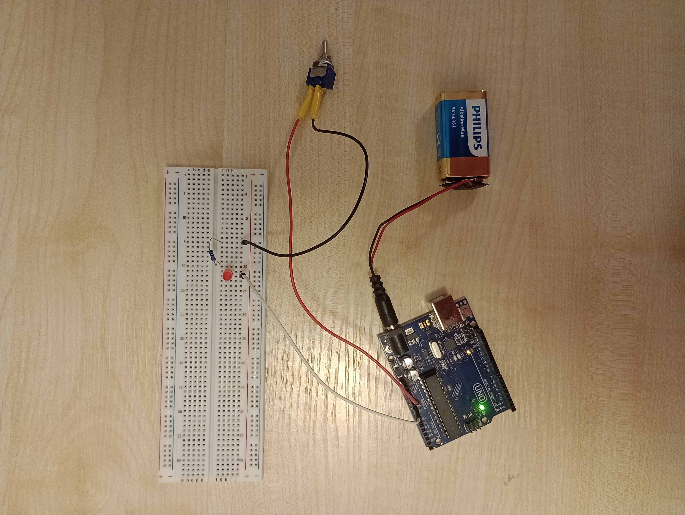
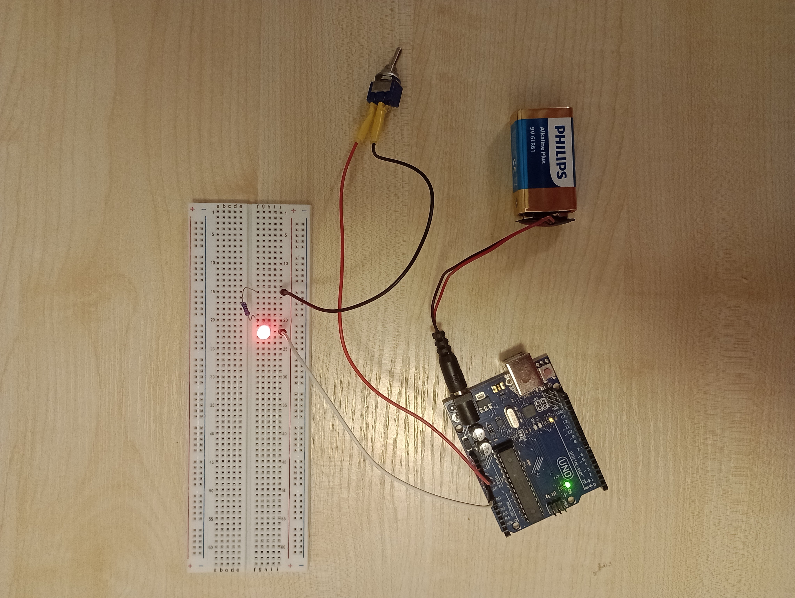

**RP2040 (Raspberry Pi Pico) Avionics Flight Computer** 
**Project Log**

## Entry - 2026-11-16 |Hardware Order, VS Code Toolchain & GitHub Setup
* **Objective 1:** Acquire the avionics hardware components
 **Actions Taken 1:**
  * Obtained necessary components for project:  
        * Raspberry Pi Pico with pre-soldered headers, 
        * DFRobot Fermion MPU-6050 `SEN0142`, 
        * Adafruit BMP388 `ADA3966`, 
        * 3.3 V MicroSD breakout `106696`, 
        * SPDT ON-ON latching toggle switch, 
        * 50 cm Micro-USB data/power cable,
        * X GB MicroSD card,
        * Male-to-Male breadboard wires,
        * Female-to-Male breadboard wires,
        * Breadboard,
        * 10K Ohm and 220 Ohm resistors,
        * Micro Servo SG90,
        * and LEDs (various colours).

* **Objective 2:** Configure the VS Code + PlatformIO C++ environment for the RP2040, and initialize version control on GitHub for `avionics_flight_computer`.
  **Actions Taken 2:**
   * Created the `avionics_flight_computer` PlatformIO project (`rpipico`, Arduino framework) in VS Code on macOS, configured `platformio.ini` with the Earle Philhower core (`maxgerhardt/platform-raspberrypi`) and Adafruit MPU6050/BMP3XX libraries, and set `Wire.setSDA(4)` and `Wire.setSCL(5)` in `src/main.cpp`.
  
   * Created the public `avionics_flight_computer` repository on GitHub without initializing a README, `.gitignore`, or license, and initialized Git, committed the baseline files, added the remote, and pushed to `main` from the VS Code terminal on macOS.

  **Verification 2:** Confirmed clean PlatformIO compilation (`[SUCCESS]`) and verified the baseline repository files (`platformio.ini`, `src/main.cpp`, `.gitignore`) were pushed to the `main` branch on GitHub.

**Issues & Next Steps:** No issues. Next, complete soldering at iForge, verify switch continuity/current flow, wire the I2C0 bus (`GP4`/`GP5` on `3.3 V`), and run the I2C scanner to detect `0x68` and `0x77`.

## Entry — 2026-11-26 | iForge Soldering & SPDT Switch Continuity Check
* **Objective:** Solder headers onto the sensor/MicroSD boards, wire leads to the SPDT toggle switch, and verify switch continuity/current flow before I2C0 bring-up.

* **Actions Taken:** Soldered headers on the MPU-6050, BMP388, and MicroSD breakout at iForge Mainspace, and soldered two leads onto the SPDT toggle switch (black on center COM lug, red on an outer lug) and secured with electrical tape.

* **Verification:** Switch cleanly opens and closes the circuit when toggled without cutting out when leads are gently wiggled, see Fig. 1.1 & 1.2 in Media. Tested switch with simple breadboard cirucit that turned an LED on and off.

* **Issues & Next Steps:** The solder had a really hard time sticking to the wire and the switch lugs so it took a few attempts. Next time, wire the I2C0 bus (GP4 SDA, GP5 SCL on 3.3 V) and run the I2C scanner to confirm addresses 0x68 and 0x77.

## New Entry

